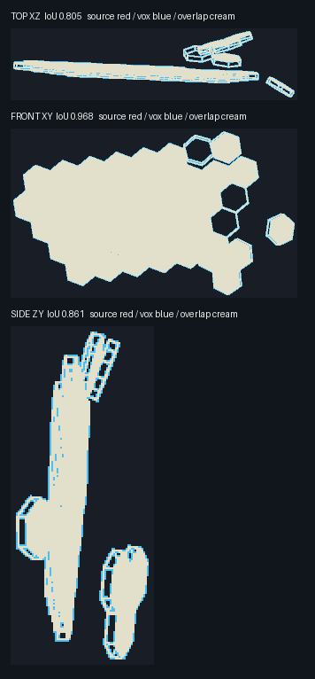
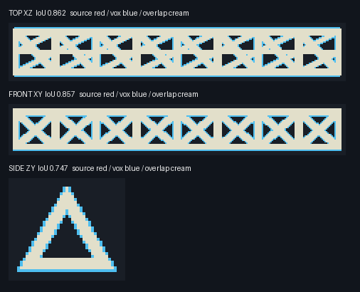
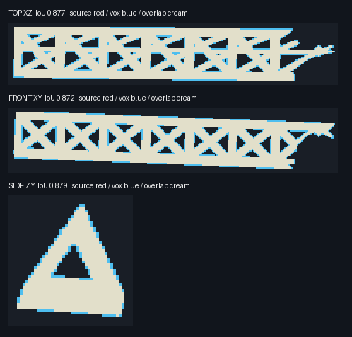
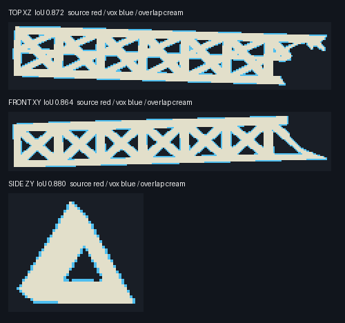
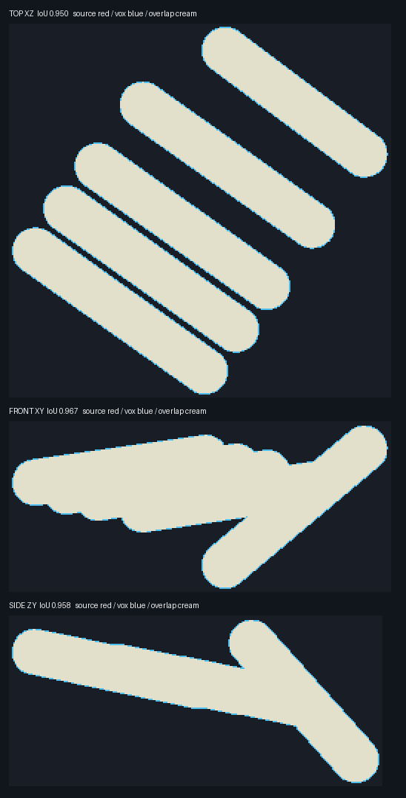
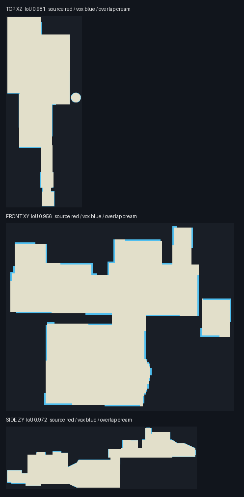

# Source-to-voxel sample fidelity

The source triangles come from the read-only Blender extraction. The candidate voxels are the geometry agent's outside-`Assets` sample manifests in `Temp/ReferenceMap20261101/GeometryHexDeck` and `GeometryTruss`. The projections below use the same local source frame as each candidate; source is red, voxel is blue, and overlap is cream. The quantitative world bounds were checked independently by transforming each candidate's occupancy cell centers and its 1 m cube half-extents into canonical Unity coordinates.

| Sample | Source shells | Connected physical assets | Cells | Max absolute boundary error | Top XZ IoU | Front XY IoU | Side ZY IoU |
| --- | --- | ---: | ---: | ---: | ---: | ---: | ---: |
| Hex deck | 497–569, 593–600 | 4 | 109,451 | 1.294 m | 0.805 | 0.968 | 0.861 |
| Central bridge truss | 127 | 1 | 38,140 | 0.912 m | 0.862 | 0.857 | 0.747 |
| Left angled truss | 0 | 1 | 32,701 | 1.108 m | 0.877 | 0.872 | 0.879 |
| Right truss extension | 134 | 1 | 32,685 | 1.176 m | 0.872 | 0.864 | 0.881 |
| Five parallel tanks | 570–574 | 5 | 124,596 | 0.960 m | 0.950 | 0.967 | 0.958 |
| Left upper equipment | 2–18 | 3 | 149,417 | 0.973 m | 0.981 | 0.956 | 0.972 |

For all six silhouette-tested samples, the candidate masks contain every projected source pixel in these three views. The blue fringe shows an outward 1 m occupancy dilation, strongest where the deck and triangular truss cross sections are thin. The deck retains its visible hex boundary gaps and detached edge pieces; all three trusses retain their repeated triangular apertures. All listed generated assets individually report one six-neighbor connected component; the largest has 92,762 cells. These checks do not establish whole-station silhouette accuracy or Player performance.

Both samples have actual occupancy records for all eight hull shapes. `source-qa-template-usage.json` lists the exact shape counts. Block7 records balance evenly across its two model offsets (172 + 172 on the deck, 64 + 64 on the truss), and Block8 balances across all eight offsets (6,733 each on the deck, 2,283 each on the truss). These counts check multi-cell record bookkeeping; the projection overlays above check the combined coarse surface fit.

The large left rounded source mass (`Cylinder.018` shell 1) produced 400,261 surface-intersecting cells in the SAT pass. This already exceeds the current 131,072-cell per-asset limit. Its consistently wound, watertight mesh encloses approximately **10.39 million m³**, so a genuinely solid 1 m fill requires more than 10.39 million occupancy cells before boundary dilation. The SAT count cannot be treated as a solid fill. A same-body segmented representation, a documented hollow-shell design, or a structurally justified physical split is required before accepting that mass; arbitrary multiple rigid bodies would alter collision and destruction behaviour. `source-volume-budget.json` contains the per-shell calculation.

Exact source and voxel AABBs, six boundary deltas, and per-view pixel counts are in `source-qa-samples.json`.

## Wide debris field

`source-qa-wide-debris.json` checks every closed shell of `tyFlow_node_515.347` against the corresponding candidate asset. All 750 shells map one-to-one to 750 independent, initially six-connected assets (374,913 cells total; largest 13,904). The maximum per-shell canonical world AABB boundary error is 0.9998 m, with p95 0.9895 m; none exceeds 2 m. This checks placement and scale for that debris family, not collision cost or the entire asteroid field.

## Adaptive solids and station coverage

The 1,279 closed `Cube.001` field shells map one-to-one to 1,279 connected, fully solid candidate rocks in `FieldAdaptiveBudgeted` (420,168 cells total; largest asset 1,589). Fixed grid sizes per rock are 331 at 1 m, 578 at 2 m, 314 at 4 m, and 56 at 5 m. Their maximum absolute source-to-voxel AABB boundary error is 4.984 m, but no rock exceeds **one of its own cells** in any AABB direction; normalized p95 is 0.992 cell. These numbers distinguish coarser intentional sampling from misplaced source instances. See `source-qa-adaptive-field.json`.

The large rounded masses are solid: left shell 1 has 91,340 cells at 5 m with 3.537 m maximum boundary error (0.707 cell); right shell 128 has 59,949 at 4 m with 3.030 m maximum boundary error (0.757 cell). Both are initially connected. Their reports are `source-qa-left-solid.json` and `source-qa-right-solid.json`.

The remaining 494 station source shells form 233 initially connected candidate assets in 13 visually defined families (960,272 cell records). Those assets explicitly use `authoredHollowShell` occupancy. Every family world AABB is within 0.999 m of its exact source family AABB. The 494 IDs and 108 previously authored sample IDs are disjoint and together cover all 602 station shells. See `source-qa-station-remainder.json`. Full source-ID coverage and placement do not prove intended contact between families or correct destruction behaviour in Unity.

## Local debris and planar field cards

All 60 closed source shells in `tyFlow_node_515.521` map one-to-one to 60 independent connected 1 m full-solid assets (34,994 cells). Maximum source-to-asset AABB boundary error is 0.999224 m; p95 is 0.988 m. See `source-qa-local-debris.json`.

All 3,065 nonwatertight planar shells in `Cube.001` are covered exactly once by 515 substitute rock instances, with no closed source shell included. Instance centers match the exact source cluster AABB centers within 5×10⁻¹³ m; their recorded PCA spans match within 3.2×10⁻¹² m. The catalog contains 28 candidate 3D source prototypes, of which 18 asset keys from nine source objects were used. These are physical 3D substitutes for source cards, not literal 1 m voxel copies of the cards. See `source-qa-card-substitutes.json`.

## Source contact evidence

Of 125 candidate voxel-overlap station asset pairs, 112 also have source triangle intersections within a 2 mm numerical tolerance. Eleven have overlapping source AABBs but no source triangle intersection or rounded-mass containment detected; two have 2.5 cm source AABB gaps. The unconfirmed pairs should not be labeled source contacts solely because their voxel cells touch. See `source-qa-station-contact-pairs.json`.

The original watertight rounded masses contain parts of nearby equipment. A separate exact ray-parity and point-to-triangle check of the six largest overlap pairs per mass found original source vertices up to 55.77 m inside the left mass and up to 44.17 m inside the right mass. This confirms authored embedding; moving those pieces to remove voxel overlap would change the reference geometry. See `source-qa-station-overlap.json`.
